<div align="center">



# 🛡️ Awesome Dynamic Application Security Testing (DAST) Tools & Ecosystem

[](https://awesome.re)
[](LICENSE)
[](https://github.com/ishandutta2007/Awesome-Dynamic-Application-Security-Testing-DAST/pulls)
[](https://github.com/ishandutta2007/Awesome-Dynamic-Application-Security-Testing-DAST)

</div>

> **Dynamic Application Security Testing (DAST)** is a black-box application security methodology that evaluates running web applications, microservices, and APIs from the exterior—simulating real-world cyberattacks without requiring internal source code access. 

This curated directory indexes the entire DAST ecosystem: enterprise SaaS vulnerability management suites, developer-first CI/CD pipeline scanners, stateful REST/GraphQL API fuzzers, and community-driven open-source penetration testing engines.

---

## 📑 Table of Contents

- [🔍 What is DAST?](#-what-is-dast)
- [⚖️ DAST vs. SAST vs. IAST Comparison](#️-dast-vs-sast-vs-iast-comparison)
- [📈 Sector Overview & Market Dynamics](#-sector-overview--market-dynamics)
- [🏢 Commercial & SaaS DAST Platforms](#-commercial--saas-dast-platforms)
- [🌐 Open-Source GitHub Projects](#-open-source-github-projects)
- [🔄 DAST CI/CD Pipeline Automation](#-dast-cicd-pipeline-automation)
- [🎯 Vulnerability Coverage & OWASP Top 10](#-vulnerability-coverage--owasp-top-10)
- [❓ Frequently Asked Questions (FAQ)](#-frequently-asked-questions-faq)
- [🤝 How to Contribute](#-how-to-contribute)
- [⚠️ Disclaimer](#️-disclaimer)
- [🏷️ Keywords & Search Taxonomy](#️-keywords--search-taxonomy)

---

## 🔍 What is DAST?

**Dynamic Application Security Testing (DAST)** executes automated security assessments against running web applications, Single Page Applications (SPAs), and APIs (REST, GraphQL, gRPC, SOAP). 

By analyzing HTTP requests and responses, injecting targeted test payloads, and observing runtime behavior, DAST scanners discover exploitable weaknesses such as:
- 💉 **Injection Flaws:** SQL Injection (SQLi), Cross-Site Scripting (XSS), Command Injection, LDAP Injection
- 🔑 **Broken Access Control & Authorization:** Broken Object Level Authorization (BOLA / IDOR), privilege escalation
- 🛡️ **Authentication Defects:** Weak session tokens, credential exposure, lack of rate limiting
- ⚙️ **Server & Cloud Misconfigurations:** CORS misconfigurations, security header deficiencies, sensitive directory exposure
- 📡 **Server-Side Request Forgery (SSRF) & Insecure Deserialization**

---

## ⚖️ DAST vs. SAST vs. IAST Comparison

Understanding where DAST fits across the Application Security (AppSec) lifecycle:

| 📐 Dimension | 🌐 DAST (Dynamic Testing) | 📜 SAST (Static Testing) | 🔬 IAST (Interactive Testing) |
|---|---|---|---|
| **Testing Approach** | Black-box (external simulation) | White-box (source code inspection) | Gray-box (instrumented runtime agent) |
| **Execution State** | Requires a running application / endpoint | Runs against uncompiled code or binaries | Runs inside runtime container during tests |
| **False Positive Rate** | Low to moderate (exploitable runtime proof) | Moderate to high (lacks runtime context) | Low (correlates code execution & payload) |
| **Language Dependency** | None (protocol & HTTP agnostic) | Language and framework dependent | Language/runtime specific (Java, .NET, Node) |
| **Detection Strengths** | Runtime configs, auth flows, API logic, WAF | Code-level bugs, hardcoded secrets, syntax | End-to-end execution path, line-of-code bugs |

---

## 📈 Sector Overview & Market Dynamics

The global Dynamic Application Security Testing (DAST) market is estimated between **$3.5 billion and $3.8 billion in 2025**, projected to surpass **$4.5 billion by 2026** at a compound annual growth rate (CAGR) of ~16–22%, driven by the explosion of cloud-native APIs, microservice architectures, and compliance mandates (SOC 2, PCI-DSS, ISO 27001).

The sector is **moderately fragmented** rather than concentrated or winner-take-all. Established AppSec giants (OpenText Fortify, Veracode, Black Duck, Checkmarx) serve large enterprise governance needs, while high-growth developer-first challengers (PortSwigger Burp Suite, Invicti, Rapid7, StackHawk, Intruder) dominate agile development workflows. Most modern security organizations rely on a multi-layered defense-in-depth model that combines commercial DAST automation with open-source scanners and manual penetration testing toolkits.

---

## 🏢 Commercial & SaaS DAST Platforms

The following enterprise and SaaS DAST platforms are sorted in descending order by company size (valuation / annual revenue).

| 🏷️ Product | 📊 Company Size (Revenue / Valuation) | 💳 Starting Tier Pricing | 🎁 Free Tier / Free Trial Limits | 🚀 Key Capabilities & Architecture |
|---|---|---|---|---|
| [Fortify WebInspect](https://www.opentext.com/products/fortify-webinspect) | **$5.17B Revenue** (~$7.53B Market Cap) | ~$25,000 / year (or ~$2,083/mo via Fortify on Demand assessment units) | No free-forever plan; 15-day assisted enterprise PoC evaluation for 1 target app | Enterprise dynamic analysis engine for complex single-page apps (SPAs), web APIs, and legacy web services with automated macro generation. |
| [Veracode Dynamic Analysis](https://www.veracode.com/products/dynamic-analysis-dast) | **$2.50B Valuation** (~$300M+ ARR) | ~$20,000 / year (DAST Essentials baseline annual subscription) | No free-forever plan; 14-day free trial of DAST Essentials (no credit card required, covers 1 designated target web application) | Cloud-scale crawler with automated authentication handling, perimeter vulnerability scanning, and unified policy compliance reporting. |
| [Black Duck Continuous Dynamic](https://www.blackduck.com/products/continuous-dynamic.html) | **$2.10B Valuation** (formerly Synopsys WhiteHat) | ~$18,000 / year (Polaris fAST Dynamic baseline annual contract) | No free-forever plan; 14-day guided enterprise Proof-of-Concept (PoC) trial (limited to 1 web application target) | Continuous production-safe web application vulnerability scanning supported by verified vulnerability analysis to filter noise. |
| [Checkmarx DAST](https://checkmarx.com/product/application-security-testing/dast/) | **$1.15B Valuation** (~$150M+ ARR) | ~$15,000 / year (Checkmarx One AppSec platform entry tier) | No free-forever plan; 14-day assisted enterprise PoC trial (requires domain verification, limited to 1 repository/app endpoint) | Integrated enterprise DAST built into Checkmarx One, correlating runtime DAST findings directly with SAST and SCA code insights. |
| [Invicti](https://www.invicti.com/) | **$1.00B+ Valuation** (~$120M+ ARR) | $7,000 / year (entry bundle covering up to 5 web targets) | No free-forever plan; 14-day guided proof-of-concept evaluation via sales demo (scoped to 1 verified FQDN) | Enterprise-grade dynamic scanner featuring Proof-Based Scanning that automatically exploits detected flaws to deliver verifiable zero-false-positive results. |
| [Acunetix](https://www.acunetix.com/) | **$1.00B+ Valuation** (part of Invicti Security) | $7,000 / year (standard 5-target FQDN annual subscription) | No free-forever plan; 14-day free trial (requires domain verification, max 1 target domain scan) | High-speed DAST scanner engineered for single-page applications (HTML5/JavaScript) with specialized deep scanning for SQLi and XSS. |
| [Rapid7 InsightAppSec](https://www.rapid7.com/products/insightappsec/) | **$859.8M Revenue** (~$1.00B Market Cap) | $175 / month per app ($2,100 / year per application, billed annually) | No free-forever plan; 30-day free trial (limited to 1 verified corporate domain or pre-configured demo test environments) | Cloud-native vulnerability management with attack replay capabilities to validate remediation without full re-scans. |
| [StackHawk](https://www.stackhawk.com/) | **$150M Valuation** ($35.3M Series B funding) | $39 / contributor per month ($468 / year per developer) for Pro/Secure; $10/mo for Wingman AI | **Free forever Developer Plan** (1 application target, 1 user environment, unlimited CI/CD scans); 14-day free trial of Pro tier | Developer-first DAST and API security platform built on top of ZAP core, designed specifically for pre-production CI/CD pipeline automation. |
| [Burp Suite Professional & Enterprise](https://portswigger.net/burp) | **~$55M Revenue** (£39M+ ARR) | $499 / user per year ($41.58/mo) for Pro; $5,999 / year for Enterprise DAST | **Free forever Community Edition** (unlimited manual proxying, Repeater, Decoder; scanner disabled); 30-day trial for Professional | De-facto industry standard pentesting proxy with automated crawl/audit engine, headless CI/CD scanning, and extensive BApp Store extensions. |
| [Intruder](https://www.intruder.io/) | **~$12M ARR** | $299 / month ($3,588 / year) for Cloud tier (includes 1 target domain + external attack surface scans) | **Free forever plan** (1 target domain, monthly basic perimeter scan); 14-day free trial of Pro tier (full authenticated web app scanning) | Cloud-based perimeter and web application scanner focused on continuous attack surface management and emerging threat notifications. |
| [AppCheck](https://appcheck-ng.com/) | **~$10M ARR** (£7M+ ARR) | £3,000 / year (~$3,850 / year, or £250/day assessment unit on G-Cloud) | No free-forever plan; 14-day free trial offering 1 complimentary full-scope web vulnerability scan report for 1 verified domain | First-principles vulnerability scanner using proprietary browser automation to test complex single-page workflows and custom APIs. |

---

## 🌐 Open-Source GitHub Projects

Curated open-source DAST scanners, web crawlers, API fuzzers, and runtime vulnerability testing frameworks. The projects below are sorted in descending order by GitHub star count, featuring real-time star badges linking directly to their stargazers page.

1. ⚡ **[mitmproxy](https://github.com/mitmproxy/mitmproxy)** [](https://github.com/mitmproxy/mitmproxy/stargazers) — An interactive TLS-capable intercepting HTTP/HTTPS and WebSocket proxy for security researchers, penetration testers, and automated runtime traffic inspection.
2. 💉 **[sqlmap](https://github.com/sqlmapproject/sqlmap)** [](https://github.com/sqlmapproject/sqlmap/stargazers) — Automatic SQL injection and database takeover engine supporting fingerprinting, DB data extraction, file system access, and out-of-band connections.
3. 🎯 **[Nuclei](https://github.com/projectdiscovery/nuclei)** [](https://github.com/projectdiscovery/nuclei/stargazers) — Fast and customizable vulnerability scanner driven by a massive community-maintained library of YAML templates targeting web applications, APIs, DNS, network protocols, and modern CVEs.
4. 🕷️ **[Katana](https://github.com/projectdiscovery/katana)** [](https://github.com/projectdiscovery/katana/stargazers) — Next-generation crawling and spidering framework supporting headless browser automation, standard web navigation, and deep endpoint discovery for DAST scanners.
5. 🚀 **[ffuf](https://github.com/ffuf/ffuf)** [](https://github.com/ffuf/ffuf/stargazers) — Extremely fast web fuzzer written in Go, widely utilized in DAST workflows for parameter discovery, hidden endpoint bruteforcing, and runtime payload injection.
6. 🛡️ **[OWASP ZAP (Zed Attack Proxy)](https://github.com/zaproxy/zaproxy)** [](https://github.com/zaproxy/zaproxy/stargazers) — The world's most widely deployed open-source DAST scanner (maintained by Checkmarx). Includes an intercepting proxy, automated active/passive scanner, REST API, Docker images, and an extensive extension marketplace.
7. 🎯 **[Sn1per](https://github.com/1N3/Sn1per)** [](https://github.com/1N3/Sn1per/stargazers) — Automated penetration testing and dynamic attack surface management platform aggregating recon, multi-tool DAST execution, and security reporting.
8. 🔎 **[Nikto](https://github.com/sullo/nikto)** [](https://github.com/sullo/nikto/stargazers) — Classic web server vulnerability scanner identifying dangerous files, outdated server installations, vulnerable CGIs, and configuration defects.
9. 🦀 **[feroxbuster](https://github.com/epi052/feroxbuster)** [](https://github.com/epi052/feroxbuster/stargazers) — High-speed, recursive content discovery tool written in Rust, purpose-built for rapid web content mapping and DAST reconnaissance.
10. 💻 **[Commix](https://github.com/commixproject/commix)** [](https://github.com/commixproject/commix/stargazers) — Automated all-in-one OS command injection and exploitation tool capable of detecting and exploiting command execution flaws in web targets.
11. 🕸️ **[w3af](https://github.com/andresriancho/w3af)** [](https://github.com/andresriancho/w3af/stargazers) — Extensible Web Application Attack and Audit Framework featuring modular crawlers, audit plugins, and exploit automation.
12. 💎 **[Arachni](https://github.com/Arachni/arachni)** [](https://github.com/Arachni/arachni/stargazers) — Modular, high-performance Ruby-based web application security scanner framework featuring differential analysis to eliminate false positives.
13. 🔬 **[RESTler](https://github.com/microsoft/restler-fuzzer)** [](https://github.com/microsoft/restler-fuzzer/stargazers) — The first stateful REST API fuzzing tool from Microsoft Research that generates dynamic test sequences based on OpenAPI/Swagger specifications to detect deep logical vulnerabilities.
14. 🏹 **[Astra](https://github.com/flipkart-incubator/Astra)** [](https://github.com/flipkart-incubator/Astra/stargazers) — Automated REST API security testing framework developed by Flipkart, testing for OWASP API Top 10 vulnerabilities including BOLA, SQLi, CSRF, and authentication bypasses.
15. 🐍 **[Wapiti](https://github.com/wapiti-scanner/wapiti)** [](https://github.com/wapiti-scanner/wapiti/stargazers) — Black-box web application vulnerability scanner written in Python 3 that crawls pages and injects payloads to audit for XSS, SQLi, SSRF, and file disclosure vulnerabilities.
16. 🧱 **[GoTestWAF](https://github.com/wallarm/gotestwaf)** [](https://github.com/wallarm/gotestwaf/stargazers) — Open-source test suite in Golang to benchmark Web Application Firewalls (WAF) and API security engines against common attack payloads.
17. 🔮 **[GraphQL-Cop](https://github.com/dolevf/graphql-cop)** [](https://github.com/dolevf/graphql-cop/stargazers) — Security auditing utility for GraphQL endpoints that detects introspection vulnerabilities, alias overloading, field duplication DOS, and batch query flaws.
18. 📦 **[Dastardly](https://github.com/PortSwigger/dastardly-github-action)** [](https://github.com/PortSwigger/dastardly-github-action/stargazers) — Free CI/CD security scanner from PortSwigger (makers of Burp Suite), engineered specifically for automated web application vulnerability scanning in CI/CD pipelines.
19. 🛡️ **[VulnAPI](https://github.com/cerberauth/vulnapi)** [](https://github.com/cerberauth/vulnapi/stargazers) — Open-source CLI and library written in Go for discovering and auditing vulnerabilities in REST APIs with OpenAPI specification scanning.
20. 🧩 **[OWASP PTK (PenTest Kit)](https://github.com/DenisPodgurskii/pentestkit)** [](https://github.com/DenisPodgurskii/pentestkit/stargazers) — Browser extension for in-browser dynamic application security testing, request decoding/tampering, and automated swagger profiling.
21. 🤖 **[Moxy](https://github.com/matank001/Moxy)** [](https://github.com/matank001/Moxy/stargazers) — Modern open-source DAST tool featuring an agentic architecture to assist, guide, and automate complex web pentesting tasks.
22. 🧰 **[justdastit](https://github.com/SnailSploit/justdastit)** [](https://github.com/SnailSploit/justdastit/stargazers) — Open-source CLI-driven DAST toolkit engineered as a lightweight alternative to commercial web pentest tools, featuring active/passive scanning and reporter utilities.
23. 📡 **[LeakRadar](https://github.com/Ajmax76/leakradar)** [](https://github.com/Ajmax76/leakradar/stargazers) — API security reconnaissance and BOLA evidence engine designed for scanning REST endpoints and identifying token privilege leaks.
24. 🔍 **[gqlhunter](https://github.com/bess1lie/gqlhunter)** [](https://github.com/bess1lie/gqlhunter/stargazers) — GraphQL reconnaissance and analysis CLI offering schema discovery, introspection querying, authentication analysis, and vulnerability risk classification.

---

## 🔄 DAST CI/CD Pipeline Automation

Modern DevSecOps workflows embed DAST directly into pull request checks and staging deployment gates:

```
+-------------------------------------------------------------------+
|               Continuous Security Pipeline (DevSecOps)            |
+-------------------------------------------------------------------+
|  1. Developer Commit & Push                                       |
|  2. SAST & Secret Detection (Static Analysis)                     |
|  3. Ephemeral Staging Environment Deployed                        |
|  4. DAST Automated Scan Triggered (OWASP ZAP / Nuclei / Dastardly)|
|  5. SARIF Report Generated & Exported to GitHub Security Tab      |
|  6. Quality Gate: Block PR on High/Critical Severity Findings     |
+-------------------------------------------------------------------+
```

### GitHub Actions Integration Example

Run an automated DAST baseline scan using the official OWASP ZAP Docker action:

```yaml
name: Dynamic Application Security Testing (DAST)

on:
  schedule:
    - cron: '0 2 * * 1'
  workflow_dispatch:

jobs:
  dast_scan:
    runs-on: ubuntu-latest
    name: Run ZAP Baseline DAST Scan
    steps:
      - name: Checkout Code
        uses: actions/checkout@v4

      - name: ZAP Baseline Scan
        uses: zaproxy/action-baseline@v0.14.0
        with:
          token: ${{ secrets.GITHUB_TOKEN }}
          docker_name: 'ghcr.io/zaproxy/zaproxy:stable'
          target: 'https://staging.example.com'
          rules_file_name: '.zap/rules.tsv'
          cmd_options: '-a'
```

---

## 🎯 Vulnerability Coverage & OWASP Top 10

DAST tools dynamically audit against the **OWASP Web Application Top 10** and **OWASP API Security Top 10**:

- 🚫 **A01:2021 - Broken Access Control:** Tested by comparing authenticated access levels across roles (IDOR/BOLA).
- 🔐 **A02:2021 - Cryptographic Failures:** Identified by inspecting SSL/TLS cipher suites and missing HSTS headers.
- 💉 **A03:2021 - Injection:** Tested via dynamic payload injection for SQL, OS command, and template injection.
- ⚙️ **A05:2021 - Security Misconfiguration:** Detected through default error messages, open admin portals, and exposed cloud metadata.
- 🆔 **A07:2021 - Identification & Authentication Failures:** Tested through credential stuffing, brute-forcing, and session timeout auditing.

---

## ❓ Frequently Asked Questions (FAQ)

### What makes DAST different from SAST?
SAST scans source code before compilation, identifying potential insecure coding practices without executing the program. DAST interacts with running applications over HTTP, validating whether a flaw is actually exploitable in the runtime environment.

### Can DAST tools test authenticated applications?
Yes. Modern DAST solutions support recorded browser authentication macros, OAuth2/OIDC token generation, HTTP basic authentication, and custom bearer tokens to scan deep behind login pages.

### How do I minimize false positives in DAST?
Choose scanners featuring proof-based verification (like Invicti) or differential analysis (like Arachni). In automated CI/CD pipelines, configure calibrated rule exclusion files and run baseline passive scans before active fuzzing.

---

## 🤝 How to Contribute

Contributions are welcome! To propose additions or updates:

1. Fork the repository.
2. Edit `README.md` following the existing format.
3. Submit a Pull Request with a clear description of the tool and verification details.

---

## ⚠️ Disclaimer

This list is curated for educational, DevSecOps engineering, and defensive security auditing purposes. DAST tools must only be used against applications and APIs where you have explicit written authorization to perform security testing. Unauthorized testing against target infrastructure is strictly illegal.

---

## 🏷️ Keywords & Search Taxonomy

`dynamic application security testing` • `DAST tools` • `web application vulnerability scanner` • `API security testing` • `REST API fuzzing` • `GraphQL security scanner` • `OWASP ZAP` • `Nuclei templates` • `Burp Suite` • `DevSecOps CI/CD security` • `black box security testing` • `runtime application security` • `automated penetration testing` • `BOLA IDOR vulnerability scanner` • `SQL injection scanner` • `XSS detection tool`
